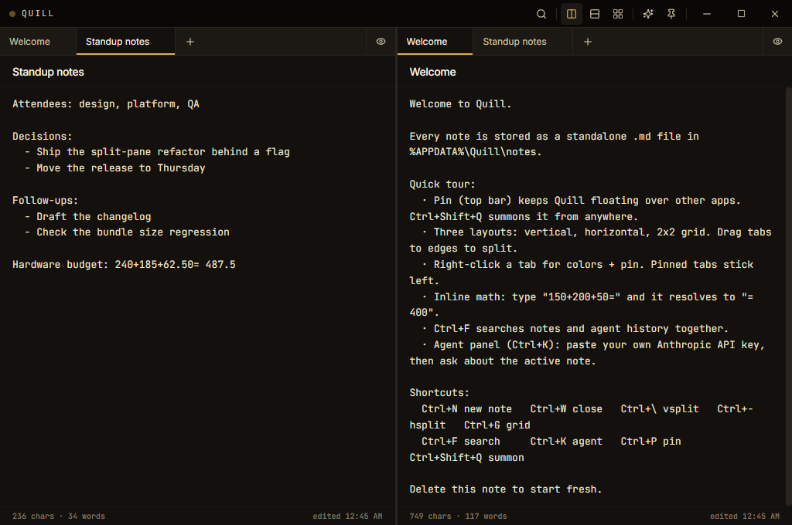

# Quill

A sharper notepad for Windows. Quill is a small Electron app for working on several notes at once: split or grid panes with independent tabs per pane, an inline calculator that resolves math as you type, an optional agent panel that streams Claude answers about the active note, and auto-update from GitHub releases. It stays out of the way: frameless, always-on-top when pinned, and summonable from any app with a global shortcut.



## Features

- **Split panes.** Vertical, horizontal, or a 2x2 grid, all resizable. Drag a tab to a pane edge to split in that direction.
- **Tabs per pane.** Each pane keeps its own tabs and active note. Right-click a tab for colors and pinning; pinned tabs stick left.
- **Always-on-top pin.** Hover Quill over any app. The pin rotates and glows amber when active.
- **Global summon.** `Ctrl+Shift+Q` shows or hides the window from anywhere in Windows.
- **Inline calculator.** Type `150+200+50=` and it resolves in place to `150+200+50= 400`. Backed by mathjs: parentheses, `%`, `^`, decimals.
- **Autocorrect.** Local and dictionary-based, fires on word boundaries. It skips capitalized words, codes, and any word you've spelled the same way elsewhere in the note. `Ctrl+Z` within 5 seconds undoes just the correction.
- **Markdown preview.** Toggle any pane between edit and rendered view. Output is sanitized with DOMPurify before rendering.
- **Search.** `Ctrl+F` searches all notes and agent conversations together and jumps to the match.
- **Agent panel.** Paste your Anthropic API key once, then ask about the active note; replies stream in token by token. The key is stored locally and requests go only to the Anthropic API. The only context sent is the active note and your conversation.
- **Autosave.** Every keystroke, debounced, one Markdown file per note. Write failures surface as a toast instead of disappearing.
- **Auto-update.** Packaged builds check GitHub releases, download in the background, and offer a one-click restart.
- **Optional knowledge-base export.** Set `knowledgeBasePath` in `settings.json` to a folder containing a `memory/` directory and a title-bar menu appears for pushing or live-syncing notes into it as Markdown. Off by default.

## Keyboard

| Shortcut | Action |
|----------|--------|
| `Ctrl+N` | New note |
| `Ctrl+W` | Close active note |
| `Ctrl+\` | Toggle vertical split |
| `Ctrl+-` | Toggle horizontal split |
| `Ctrl+G` | Toggle 2x2 grid |
| `Ctrl+F` / `Ctrl+Shift+F` | Search notes and agent history |
| `Ctrl+K` | Toggle agent panel |
| `Ctrl+P` | Toggle pin (always-on-top) |
| `Ctrl+Shift+Q` | Summon or hide Quill (global) |

## Run

Requires Node 22 (the version CI uses) and npm.

```bash
npm install
npm run dev         # hot-reload dev mode
```

Checks:

```bash
npm run typecheck   # tsc --noEmit
npm run build       # bundle main, preload, and renderer
```

## Build the Windows installer

```bash
npm run dist:win
```

This produces the NSIS installer at `release/Quill-Setup-<version>.exe`, plus an unpacked build at `release/win-unpacked/Quill.exe`. electron-builder needs symlink privileges to unpack its signing tooling, so run this with Windows Developer Mode enabled or from an elevated shell. Without that privilege the unpacked `Quill.exe` still builds; only the installer step fails.

## Storage

Everything lives in `%APPDATA%\Quill`:

- `notes/<id>.md`: one Markdown file per note, with YAML frontmatter (title, timestamps, color).
- `agent-log/<id>.md`: the agent conversation for each note, timestamped per message.
- `settings.json`: window bounds, layout, and the Anthropic API key. The key is stored in plaintext, so treat the folder as sensitive.

Delete the folder to reset the app. Versions before 1.0 used a single `quill-data.json`; it migrates automatically on first launch.

## Privacy

Notes stay on your machine. Three things touch the network: agent requests (the active note plus your question, sent to the Anthropic API under your key), the auto-update check against GitHub releases in packaged builds, and the UI fonts (Inter, JetBrains Mono) fetched from Google Fonts at launch. Offline, the app falls back to system fonts and everything else works.

## Status

Maintained personal tool. Windows is the packaged and tested target; macOS and Linux are untested.

## Stack

Electron 33, electron-vite, React 18, TypeScript, Tailwind, mathjs, marked + DOMPurify, @anthropic-ai/sdk, electron-updater.

## License

MIT. See [LICENSE](LICENSE).
